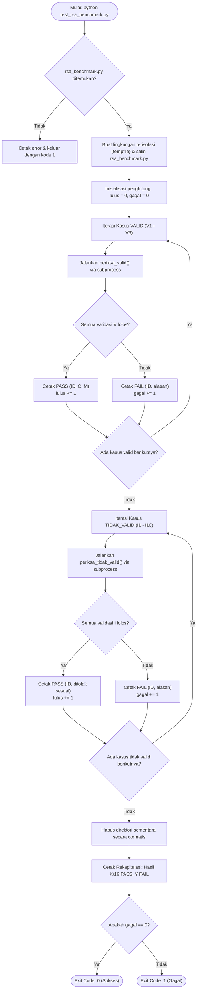
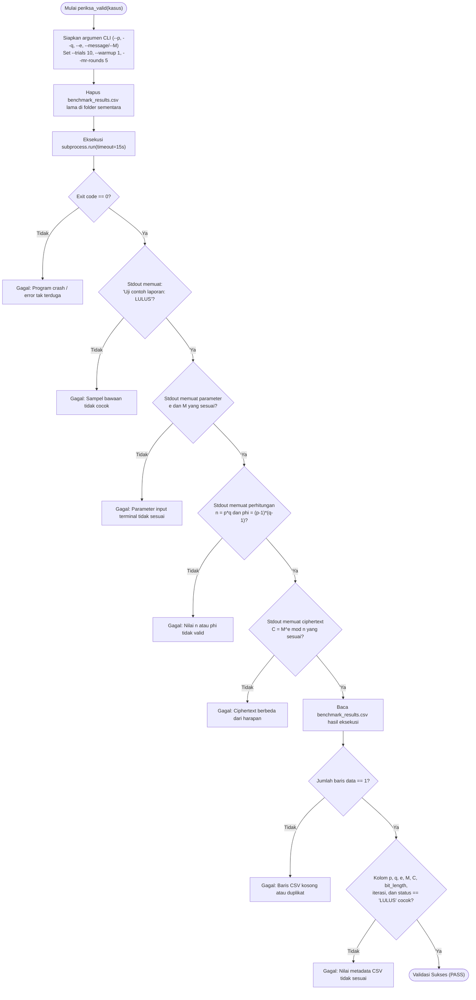
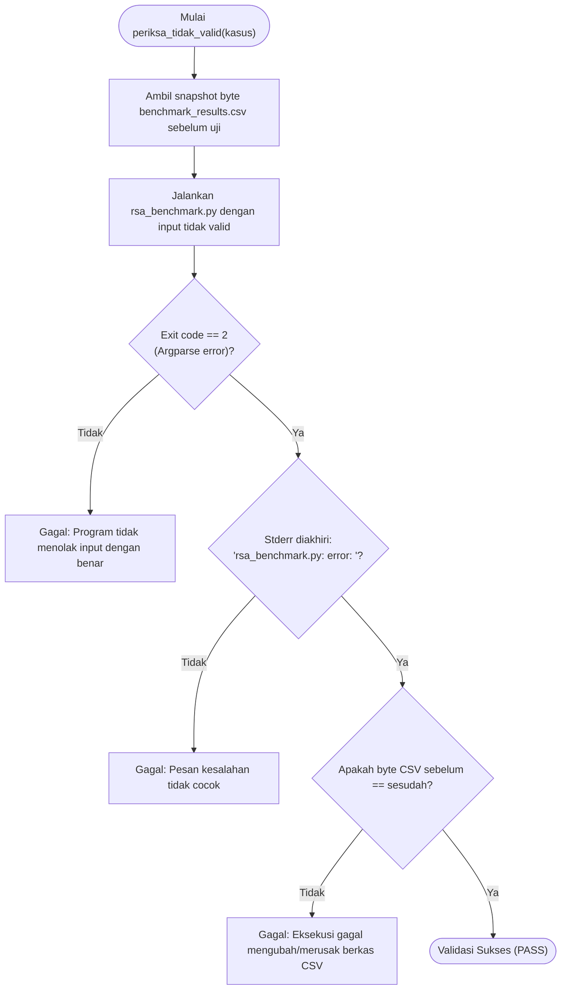

# Alur Pengujian (Flow Testing) RSA & RSA-CRT

Dokumen ini menjelaskan alur pengujian otomatis pada skrip [`test_rsa_benchmark.py`](test_rsa_benchmark.py). Skrip ini memverifikasi kebenaran implementasi matematika RSA, penanganan galat (*error handling*), serta integritas berkas keluaran CSV secara terisolasi.

---

## 1. Diagram Alir Pengujian Keseluruhan (High-Level Testing Flow)

Berikut adalah diagram alir eksekusi pengujian dari awal hingga pelaporan hasil:



---

## 2. Alur Detail Pengujian Kasus Valid (`periksa_valid`)

Fungsi `periksa_valid()` memastikan program memproses parameter yang benar, menghasilkan output matematika yang tepat, dan menulis data ke CSV tanpa kesalahan.



### Cakupan Kasus Valid (V1 – V6)
1. **V1**: Pengujian contoh laporan resmi ($p=43, q=59, e=13, M=1819 \rightarrow C=2081$).
2. **V2**: Pengujian opsi alias `--M` menggantikan `--message` ($p=61, q=53, e=17, M=65 \rightarrow C=2790$).
3. **V3**: Pengujian batas bawah pesan ($M=0 \rightarrow C=0$).
4. **V4**: Pengujian batas atas pesan ($M = n - 1 = 2536 \rightarrow C=2536$).
5. **V5**: Pengujian pasangan prima dan eksponen berbeda ($p=17, q=61, e=7, M=42 \rightarrow C=423$).
6. **V6**: Pengujian pesan yang membagi modulus ($M = p = 43 \rightarrow C=1935$).

---

## 3. Alur Detail Pengujian Kasus Tidak Valid (`periksa_tidak_valid`)

Fungsi `periksa_tidak_valid()` memastikan program menolak input yang melanggar aturan matematika atau konfigurasi CLI, mengembalikan pesan kesalahan yang spesifik, dan tidak merusak berkas data.



### Cakupan Kasus Tidak Valid (I1 – I10)
| ID | Kategori Kesalahan | Kondisi Input | Pesan Kesalahan yang Diharapkan |
|---|---|---|---|
| **I1** | Uji Keprimaan Miller-Rabin | $p=45$ (bukan prima) | `p tidak lolos uji Miller-Rabin.` |
| **I2** | Uji Keprimaan Miller-Rabin | $q=55$ (bukan prima) | `q tidak lolos uji Miller-Rabin.` |
| **I3** | Integritas Pasangan Prima | $p=43, q=43$ ($p = q$) | `p dan q harus prima ganjil yang berbeda.` |
| **I4** | Keterbalikan Modular (Bezout) | $e=3, \phi=2436$ ($\gcd(e, \phi) = 3 \neq 1$) | `Invers tidak ada: a dan modulus harus relatif prima.` |
| **I5** | Paritas Eksponen | $e=2$ (genap) | `e harus ganjil dan lebih besar dari 1.` |
| **I6** | Domain Eksponen | $e=2437 \ge \phi(n)$ | `e harus memenuhi 1 < e < phi.` |
| **I7** | Batas Bawah Pesan | $M = -1 < 0$ | `Pesan harus memenuhi 0 <= M < n.` |
| **I8** | Batas Atas Pesan | $M = 2537 \ge n$ | `Pesan harus memenuhi 0 <= M < n.` |
| **I9** | Kelengkapan Argumen CLI | Memberikan `--p` tanpa `--q` | `--p dan --q harus diberikan bersama.` |
| **I10** | Konflik Mode CLI | Memberikan `--p/--q` bersama `--prime-bits` | `Pilih --p/--q manual atau --prime-bits otomatis.` |

---

## 4. Keunggulan Arsitektur Pengujian

1. **Isolasi Penuh (*Sandbox Isolation*)**:
   - Menggunakan `tempfile.TemporaryDirectory()`.
   - Hasil benchmark pengguna yang ada di folder kerja tidak akan tertimpa atau hilang saat pengujian berjalan.
2. **Pengujian *End-to-End* Melalui Subprocess**:
   - Tidak hanya menguji fungsi internal secara parsial, tetapi memverifikasi keseluruhan eksekusi program dari input argumen CLI, pembacaan terminal, hingga pembentukan berkas CSV.
3. **Verifikasi Tiga Lapis (*Three-Tier Verification*)**:
   - **Tingkat 1 - Exit Code**: Memastikan status terminasi proses (0 untuk sukses, 2 untuk galat input).
   - **Tingkat 2 - Terminal Output**: Memeriksa pesan stdout/stderr secara presisi.
   - **Tingkat 3 - File Integrity**: Memeriksa struktur header, tipe data, dan nilai numerik di dalam `benchmark_results.csv`.
4. **Keamanan Data (*No Side-Effects*)**:
   - Kasus salah (`I1` - `I10`) dipastikan tidak meninggalkan berkas sampah atau mengubah CSV yang sudah ada.

---

## 5. Cara Menjalankan Uji

Buka PowerShell pada direktori proyek dan jalankan:

```powershell
python .\test_rsa_benchmark.py
```

Jika seluruh 16 pengujian lulus, output terminal akan menampilkan:

```text
PASS V1: C = 2081, M = 1819
PASS V2: C = 2790, M = 65
PASS V3: C = 0, M = 0
PASS V4: C = 2536, M = 2536
PASS V5: C = 423, M = 42
PASS V6: C = 1935, M = 43
PASS I1: input ditolak dengan pesan yang sesuai.
PASS I2: input ditolak dengan pesan yang sesuai.
PASS I3: input ditolak dengan pesan yang sesuai.
PASS I4: input ditolak dengan pesan yang sesuai.
PASS I5: input ditolak dengan pesan yang sesuai.
PASS I6: input ditolak dengan pesan yang sesuai.
PASS I7: input ditolak dengan pesan yang sesuai.
PASS I8: input ditolak dengan pesan yang sesuai.
PASS I9: input ditolak dengan pesan yang sesuai.
PASS I10: input ditolak dengan pesan yang sesuai.

Hasil: 16/16 PASS, 0 FAIL.
```